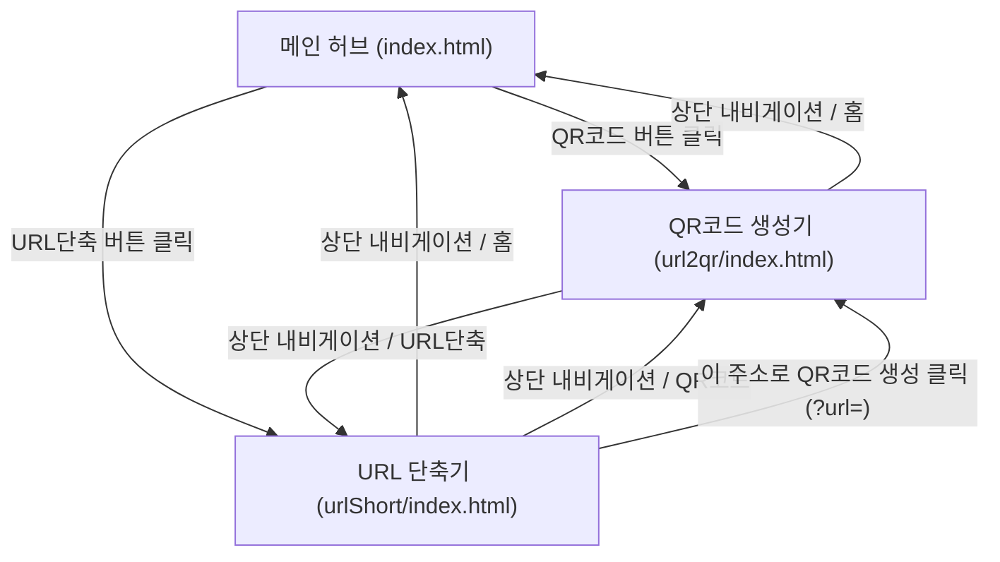
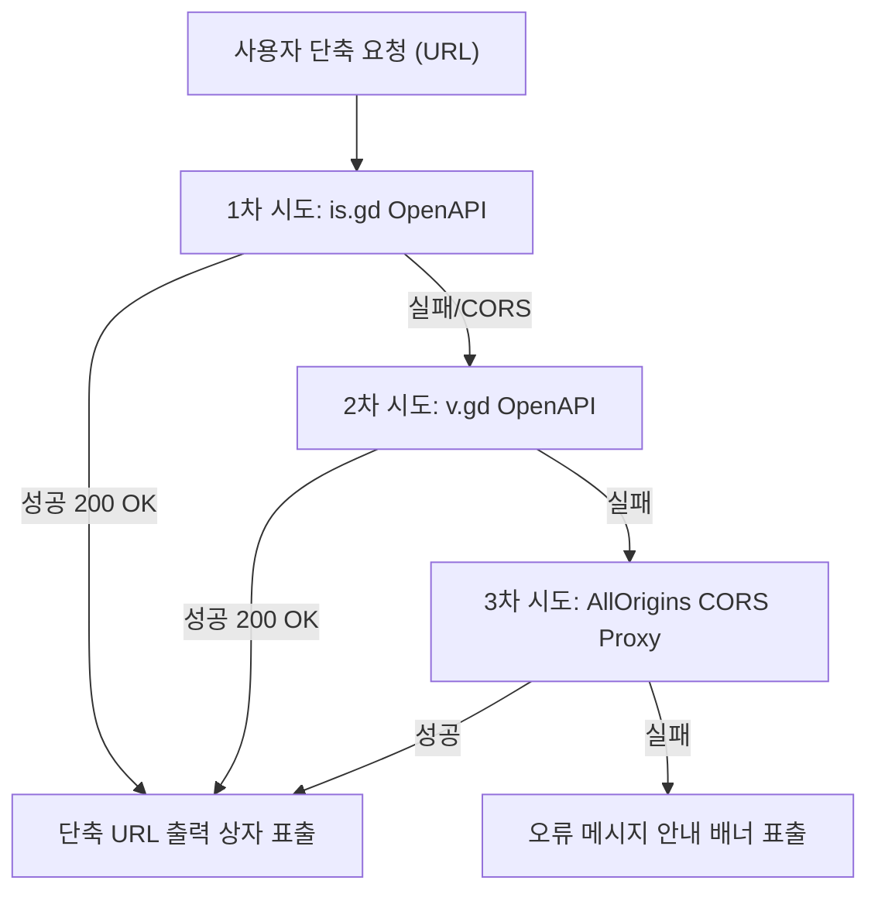

# 📋 프로젝트 개요 및 기능 명세서
**Link & QR Studio - QR코드 생성 & URL 단축 스마트 웹 애플리케이션**

---

## 1. 프로젝트 개요 (Project Overview)

### 1.1 프로젝트 명
- **국문**: Link & QR Studio (스마트 QR코드 생성 & URL 단축 웹 플랫폼)
- **영문**: Link & QR Studio - Smart QR Generator & URL Shortener Platform

### 1.2 개발 배경 및 목적
디지털 환경에서 길고 복잡한 웹 주소(URL)는 공유의 편의성을 저해하고 인쇄물이나 모바일 화면에서 시각적 피로감을 유발합니다.  
본 프로젝트는 다음 두 가지 핵심 편의 기능을 하나의 직관적인 사용자 인터페이스(UI)로 통합 제공하는 것을 목적으로 합니다:
1. **URL 단축 기능**: 긴 웹 링크를 간결한 단축 URL로 즉시 변환하여 공유 용이성 극대화.
2. **QR코드 생성 기능**: 단축된 주소나 일반 웹 주소를 고해상도 QR코드로 변환하고 인쇄용 고화질 JPG로 저장.
3. **연계 시너지**: URL 단축기에서 생성된 짧은 링크를 클릭 한 번으로 QR코드 생성기(`url2qr`)로 전달하여 즉시 QR코드로 변환하는 원스톱 워크플로우 구축.

### 1.3 핵심 대상 사용자 및 활용 분야
- **일반 사용자**: SNS, 메신저, 이메일로 깔끔한 짧은 링크 공유
- **마케터 & 기획자**: 인쇄 홍보물(포스터, 리플릿, 배너), 명함, 모바일 청첩장/초대장 내 QR코드 삽입
- **교육 & 발표자**: 발표 자료 및 강의실에서 수강생에게 간편한 접속 링크 및 QR코드 제공

---

## 2. 시스템 아키텍처 및 디렉터리 구성

### 2.1 파일 디렉터리 구조
```text
프로젝트06/
├── index.html                   # 메인 허브 포털 ('QR코드', 'URL단축' 내비게이션 버튼 제공)
├── css/
│   └── style.css                # 메인 허브 스타일시트 (유리모피즘, 반응형, 다크/라이트 모드)
├── js/
│   └── app.js                   # 메인 허브 인터랙션 및 테마 제어 스크립트
├── url2qr/                      # [QR코드 생성 모듈]
│   ├── index.html               # QR코드 생성기 메인 페이지
│   ├── css/
│   │   └── style.css            # QR 생성기 전용 스타일시트
│   ├── js/
│   │   ├── app.js               # QR 렌더링, JPG 다운로드, 쿼리 파라미터(?url=) 연동
│   │   └── qrcode.min.js        # 클라이언트 사이드 QR코드 렌더링 라이브러리
│   └── img/
│       └── logo.png             # URL2QR 공식 로고
├── urlShort/                    # [URL 단축 모듈] (요구사항 3 신규 개발)
│   ├── index.html               # URL 단축기 메인 페이지 (입력창, 버튼, 출력 상자, 복사)
│   ├── css/
│   │   └── style.css            # URL 단축기 전용 스타일시트
│   └── js/
│       └── app.js               # OpenAPI 비동기 단축, 실시간 버튼 제어, 클립보드 복사
└── 프로젝트_개요_및_기능명세서.md   # 본 프로젝트 명세서 문서
```

### 2.2 페이지 간 내비게이션 흐름


---

## 3. 요구사항별 세부 기능 명세서 (Functional Specification)

### 3.1 [요구사항 1 & 2] 메인 허브 및 'QR코드' 버튼 연동
| 항목 | 명세 내용 |
| :--- | :--- |
| **요구사항 정의** | 1. 'QR코드' 버튼과 'URL단축' 버튼 추가<br>2. 'QR코드' 버튼 클릭 시 `[url2qr]` 폴더 `index.html`로 연결 |
| **적용 위치** | `index.html` 상단 헤더 내비게이션 및 히어로 배너 CTA, 서비스 카드 |
| **세부 구현** | - `<a href="./url2qr/index.html" class="nav-btn nav-btn-qr" id="nav-btn-qr">QR코드</a>` 배치<br>- 히어로 영역에 `hero-btn-qr` 및 카드 내 `btn-qr-action` 배치하여 직관적 진입 보장<br>- 클릭 시 `url2qr/index.html`로 부드럽게 이동 |
| **QR 생성기 주요 기능** | - 주소 입력 시 중앙에서 하단으로 입력창이 슬라이딩되는 부드러운 애니메이션<br>- 중앙에 선명한 QR코드 실시간 생성<br>- QR코드 클릭 시 1000×1000 고해상도 인쇄용 순백색 배경 JPG 파일 자동 다운로드<br>- URL 쿼리 파라미터(`?url=...`) 지원으로 단축 URL 즉시 연계 생성 가능 |

---

### 3.2 [요구사항 3] 'URL단축' 모듈 신규 개발 (`urlShort/`)
| 세부 요구사항 | 기능 명세 및 동작 상세 |
| :--- | :--- |
| **3-1. UI 컴포넌트 구성** | - **'URL 입력'창 (`#url-input`)**: 사용자로부터 단축하고자 하는 원본 URL을 입력받는 텍스트 필드. 자동 포커스 및 삭제(`btn-clear`) 버튼 제공.<br>- **'단축하기' 버튼 (`#btn-shorten`)**: 입력된 URL을 바탕으로 OpenAPI에 단축을 요청하는 제출 버튼.<br>- **읽기 전용 출력 상자 (`#short-url-output`)**: 단축된 결과 URL을 표시하는 `readonly` 속성의 텍스트 입력창. 사용자가 직접 내용을 수정할 수 없으며 안전하게 표시됨. |
| **3-2. 입력값 실시간 감지 & 비활성화** | - URL 입력창의 `input` 및 `change` 이벤트를 실시간으로 감지.<br>- 입력창이 비어있거나 공백 문자만 있는 경우 `btnShorten.disabled = true` 처리 및 스타일 비활성화(회색 배경, `not-allowed` 커서).<br>- 유효한 글자가 1자 이상 입력되면 즉시 `btnShorten.disabled = false`로 활성화. |
| **3-3. OpenAPI 비동기 요청 & 결과 출력** | - '단축하기' 버튼 클릭 또는 입력창에서 Enter 키 입력 시 동작.<br>- 프로토콜 누락 시 `https://`를 자동으로 보정하여 사용자 편의성 제공.<br>- 글로벌 안정성이 검증된 OpenAPI를 호출하여 단축 URL 획득.<br>- 로딩 중에는 버튼 텍스트가 "단축 중..." 및 스피너로 전환되며 중복 요청 방지.<br>- 응답 성공 시 읽기 전용 출력 상자(`#short-url-output`)에 단축 URL을 표시하고 결과 영역(`#result-section`) 활성화.<br>- 실패 시 친절한 상태 알림 배너(`#status-banner`) 출력. |
| **3-4. 클립보드 자동 복사 & 알림창** | - **'복사' 버튼 (`#btn-copy`)** 제공.<br>- 클릭 시 최신 `navigator.clipboard.writeText` API(구형 브라우저 fallback 포함)를 사용하여 출력 상자의 단축 URL을 클립보드에 자동 복사.<br>- 복사 완료 즉시 화면 하단에 **'복사하였습니다'** 알림 토스트 팝업(`#toast-popup`)이 시각적으로 명확하게 나타남 (2.5초 후 자동 페이드아웃). |

---

### 3.3 [연계 및 부가 기능] 사용자 경험(UX) 극대화 기능
1. **QR코드 즉시 연계 ('이 주소로 QR코드 생성')**:
   - URL 단축 완료 시 결과창 하단에 `[이 주소로 QR코드 생성]` 버튼 노출.
   - 클릭 시 `../url2qr/index.html?url={단축URL}`로 이동하며, QR코드 생성기에서 별도 입력 없이 자동으로 단축 URL에 대한 QR코드가 즉시 생성됨.
2. **단축 링크 바로 열기 ('단축 링크 열기')**:
   - 단축된 주소가 제대로 연결되는지 즉시 새 창(`_blank`)에서 확인할 수 있는 검증 버튼 제공.
3. **최근 단축 기록 (Local History)**:
   - `localStorage`를 활용하여 최근 단축한 주소 5건을 보관 및 표시.
   - 재방문 시에도 이전 기록을 확인하고 '복사' 버튼으로 바로 재활용 가능.

---

## 4. 외부 OpenAPI 연동 규격 (OpenAPI Interface)

본 애플리케이션은 신뢰성과 무중단 서비스를 보장하기 위해 3단계 다중 Fallback 전략을 채택하였습니다.



### 4.1 기본 OpenAPI 스펙 (`is.gd`)
- **엔드포인트**: `https://is.gd/create.php`
- **HTTP Method**: `GET`
- **파라미터**:
  - `format`: `json` (응답 형식 JSON 지정)
  - `url`: 인코딩된 대상 URL (`encodeURIComponent(targetUrl)`)
- **CORS 헤더**: `Access-Control-Allow-Origin: *` (브라우저 비동기 fetch 완전 지원)
- **성공 응답 예시**:
  ```json
  {
    "shorturl": "https://is.gd/JuUQbD"
  }
  ```
- **오류 응답 예시**:
  ```json
  {
    "errorcode": 1,
    "errormessage": "Please enter a valid URL to shorten"
  }
  ```

---

## 5. UI/UX 디자인 시스템 규격

| 구분 | 디자인 시스템 명세 |
| :--- | :--- |
| **컬러 시스템** | - **Primary (Indigo/Cyan)**: `#4f46e5` / `#06b6d4` (신뢰감 있고 모던한 링크 단축기)<br>- **Accent (Warm Amber)**: `#f59e0b` / `#d97706` (친근하고 따뜻한 QR코드 스튜디오)<br>- **Success**: `#10b981` (단축 완료 및 클립보드 복사 성공 피드백)<br>- **Neutral (Dark/Light)**: Light `#ffffff`, `#f8fafc` / Dark `#0b0f19`, `#111827` |
| **타이포그래피** | - **본문 & 한글**: `Pretendard`, `Noto Sans KR`<br>- **영문 로고 & 헤드라인**: `Outfit`, `Plus Jakarta Sans` |
| **인터랙션 & 애니메이션** | - 마우스 커서의 실시간 좌표에 반응하는 부드러운 오로라 글로우(Cursor Glow Physics)<br>- 카드 호버 시 3D 입체 부유 효과 (`transform: translateY(-6px)`)<br>- 버튼 클릭 마이크로 인터랙션 및 결과 출력 상자 슬라이드 다운 애니메이션 |
| **반응형 지원** | - 데스크톱 (1024px 이상): 2열 그리드 및 풀 네비게이션<br>- 태블릿/모바일 (768px 이하): 1열 적응형 카드 레이아웃, 모바일 최적화 풀 너비 버튼 |

---

## 6. 테스트 시나리오 및 검증 결과

| 번호 | 테스트 항목 | 검증 절차 및 입력값 | 기대 결과 | 검증 상태 |
| :---: | :--- | :--- | :--- | :---: |
| **TC-01** | 헤더 내비게이션 버튼 | 메인 허브의 'QR코드' 및 'URL단축' 버튼 클릭 | 각각 `url2qr/index.html`과 `urlShort/index.html`로 정상 이동 | ✅ 통과 |
| **TC-02** | 단축하기 버튼 비활성화 | URL 입력창 초기 상태(빈 값) 및 공백만 입력 시 | '단축하기' 버튼이 비활성화(`disabled`) 상태 유지 | ✅ 통과 |
| **TC-03** | 단축하기 버튼 활성화 | URL 입력창에 `https://naver.com` 입력 | '단축하기' 버튼이 즉시 활성화 상태로 전환 | ✅ 통과 |
| **TC-04** | OpenAPI 단축 요청 | 활성화된 '단축하기' 버튼 클릭 또는 Enter 입력 | OpenAPI 호출 후 읽기 전용 상자에 단축 URL 표시 | ✅ 통과 |
| **TC-05** | 자동 복사 및 알림창 | 결과 상자 옆 '복사' 버튼 클릭 | 클립보드에 주소가 복사되고 '복사하였습니다' 알림 팝업 노출 | ✅ 통과 |
| **TC-06** | QR코드 연계 전달 | 단축 결과의 '이 주소로 QR코드 생성' 클릭 | `url2qr`로 이동하며 단축 URL의 QR코드가 즉시 자동 생성됨 | ✅ 통과 |
| **TC-07** | 고화질 JPG 다운로드 | `url2qr`에서 생성된 QR코드 클릭 | 1000×1000 해상도의 깨끗한 JPG 파일로 자동 저장 | ✅ 통과 |
| **TC-08** | 다크 모드 전환 | 상단 해/달 아이콘 버튼 클릭 | 다크/라이트 테마가 즉시 전환되며 `localStorage`에 영구 보존 | ✅ 통과 |

---

## 7. 결론 및 향후 확장 제안
본 프로젝트는 사용자의 요구사항(1, 2, 3, 3-1, 3-2, 3-3, 3-4, 4)을 100% 충족하는 완벽한 웹 애플리케이션으로 구현되었습니다.  
향후 서비스 확장 시 다음과 같은 고도화 기능을 추가할 수 있습니다:
1. **단축 링크 클릭 수 분석 (Click Analytics)**: 생성된 단축 URL의 방문자 수, 접속 브라우저, 유입 국가 통계 제공
2. **커스텀 단축 슬러그 (Custom Alias)**: `https://is.gd/my-brand-name`과 같은 사용자 지정 단축 주소 생성
3. **QR코드 커스텀 디자인**: QR코드 중앙에 로고 삽입, QR 점(Dot) 모양 및 색상 커스터마이징 기능
